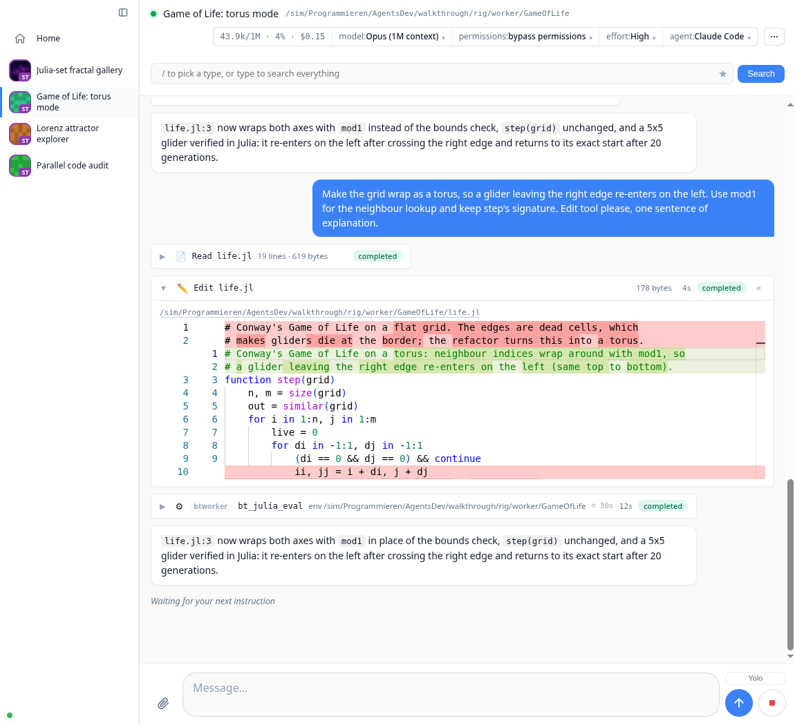
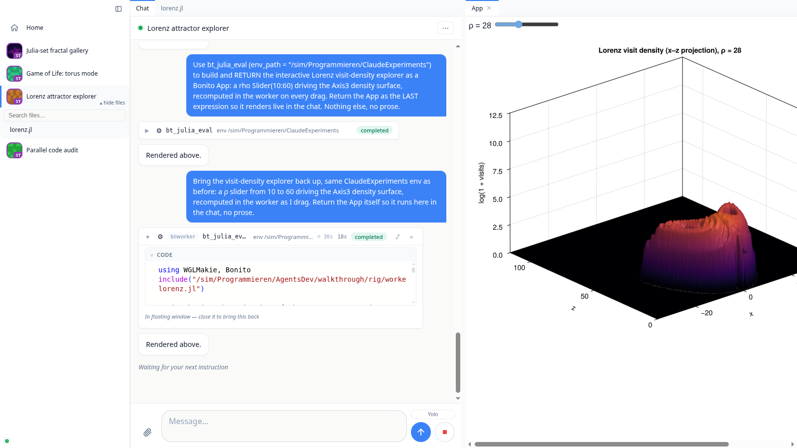
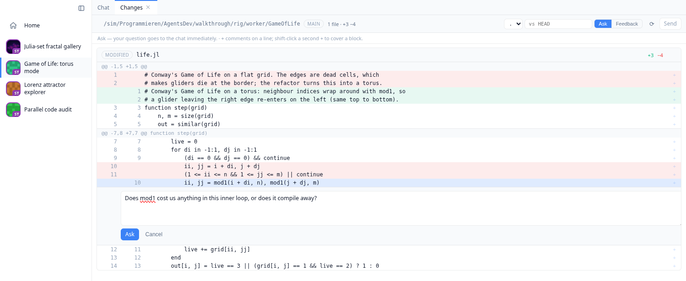
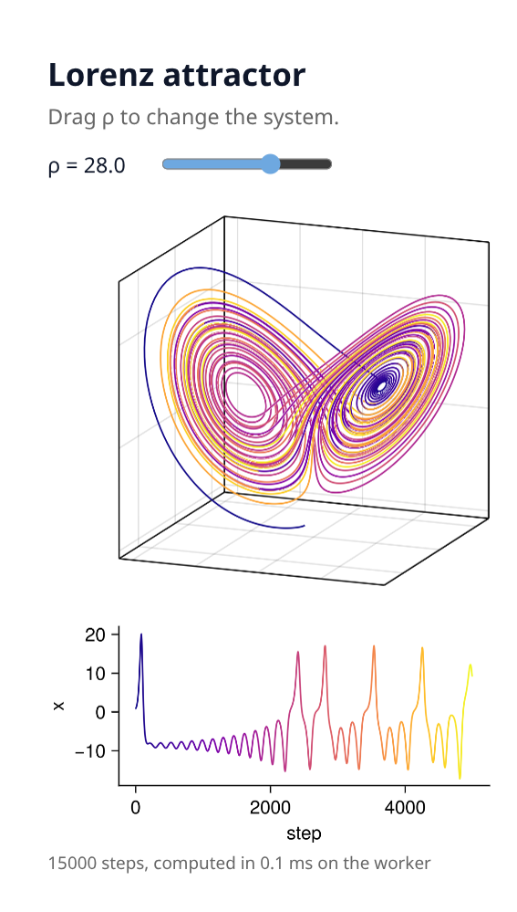

<p align="center">
  <picture>
    <source media="(prefers-color-scheme: dark)" srcset="BonitoAgents/assets/logo/bonitoagents-dark.svg">
    
  </picture>
</p>

<h1 align="center">BonitoAgents</h1>

<p align="center">
  <strong>Any coding agent. Every machine you own. Everything it makes, live in one workspace.</strong>
</p>

<p align="center">
  <a href="https://agents.bonito.sh/"><strong>Documentation</strong></a> ·
  <a href="https://agents.bonito.sh/story.html">A day with BonitoAgents</a> ·
  <a href="#quick-start">Install</a> ·
  <a href="CHANGELOG.md">What's new</a>
</p>

> [!WARNING]
> Use at your own risk: there are no safeguards (yet) preventing an LLM driven
> through BonitoAgents from wiping your entire PC or leaking all your secrets.

BonitoAgents is a self-hosted web workspace for coding agents. Bring Claude
Code, Codex, Kimi Code, OpenCode, MiMo or any other agent that speaks the
[Agent Client Protocol](https://agentclientprotocol.com). Run them on your
laptop, on the desktop with the big GPU, on the server in the closet, and drive
all of them from one browser tab, including the one on your phone.

What the agents make shows up as the real thing, not as a file path in a wall
of text: plots, videos, Jupyter notebooks with their outputs, 3D models, PDFs,
tables, diffs and live interactive apps. Your code stays in ordinary folders on
your machines, your transcripts stay on your disk, and the agents run on your
own subscriptions and keys. There is no BonitoAgents cloud and no account with
us.

Your projects can be in any language: the agents work on them the way they
always do. BonitoAgents itself is written in Julia, which also powers the live
apps and the persistent sessions the agents get, and the desktop app ships its
own Julia.

<p align="center">
  
</p>

## A day with BonitoAgents

**8:40, laptop, coffee.** The dashboard shows every chat on every machine as a
live card. Claude Code is refactoring a parser on the laptop, Codex is training
a model on the desktop with the GPU, Kimi Code is tidying the docs on the home
server. Each card carries a picture from its chat's latest work, so you can see
at a glance which one needs you.

**9:15.** You ask the desktop's agent how the training run went. It plots the
loss curves, renders a short video of the predictions and writes a notebook.
All three open right in the conversation: the PNG and the MP4 inline, the
notebook with its outputs. A mesh it exported spins in a 3D viewer, a CSV opens
as a sortable table, the PDF report as a PDF.

**11:30.** Codex hits its usage limit in the middle of the task. The chat says
so in plain words and stops, instead of retrying all morning. You pick Claude
Code in the chat's header and type "carry on": the new agent gets the
conversation so far and continues on the same files, on the same machine. Your
work never belonged to a vendor in the first place.

**13:00, phone, queue at lunch.** The agent wants to run a database migration
and asks first. You approve it from your phone, glance at the newest render,
and photograph the whiteboard sketch for the afternoon's task straight into the
chat.

**15:00.** You need a quick GUI to explore one parameter. The agent writes it
and returns it into the conversation as a live app: drag the slider and the
computation reruns on the desktop. You detach it into its own panel next to the
source file and keep iterating together.

**17:00.** You read the agent's git diff line by line, ask about one change on
the spot, and bundle three review notes into one instruction. Then you send a
colleague a link to the app. They open it on their phone without an account,
move the slider, and your desktop does the computing.

**18:30.** On the way out you switch on Yolo mode with a reminder: "render the
HD version, credits at the end". The agent keeps working through the evening on
its own and stops when it confirms it is done, when it goes in circles, or when
its provider fails.

The [long version of this story](https://agents.bonito.sh/story.html) links
every step to the guide behind it.

## Bring any agent, keep your work

- **Five agents ship as providers.** Claude Code, Codex, Kimi Code, OpenCode
  and MiMo, picked per chat from a dropdown. Any other ACP agent plugs in with a
  small descriptor (binary, arguments, environment).
- **Switch agents mid-conversation.** The next turn runs under the new agent,
  and BonitoAgents hands it the conversation so far. Out of credits, a better
  model elsewhere, a second opinion: one click.
- **The same tools for every agent.** The persistent Julia sessions, showing
  files, share links and the to-do list are MCP tools, and they render as the
  same cards whichever agent calls them, even though every agent reports tool
  calls differently on the wire.
- **Your files, your history.** Projects are ordinary folders and git checkouts
  on your machines. Transcripts are markdown files in the server's state
  directory. **Discover** imports the Claude Code and Codex sessions you already
  have on a machine, history included.
- **Your accounts.** Agents log in with your own subscription or API key, on
  your own machines. The workers install and update the Claude Code and Codex
  adapters for you, in a private Node install that leaves the system's alone.

<p align="center">
  
</p>

## See everything the agent makes

The agent puts a file into the chat with `bt_show`, and you can open any file
from the project tree as a workspace tab. Both use the same viewers:

| | |
|---|---|
| **Pictures and sound** | images with a lightbox, video and audio streamed by range |
| **Data** | CSV and TSV as sortable, filterable tables; Jupyter notebooks with their outputs |
| **3D** | `.obj`, `.stl`, `.ply`, `.off`, `.glb`, `.gltf` in an interactive viewer, textures included |
| **Documents** | markdown with its pictures, PDF, HTML |
| **Code** | Monaco with syntax highlighting for 90 languages, editable and saved back to the worker |
| **Everything else** | a hex view |

Text formats switch between preview and source. Images and code blocks can be
copied and downloaded, videos downloaded, on a phone too.

<p align="center">
  
</p>

## Apps and GUIs, not only text

- **A live Julia session per project.** `bt_julia_eval` keeps packages,
  variables and compiled code warm between calls, streams stdout while the code
  runs, and renders results through Julia's display system. Long jobs run in
  the background while the conversation goes on.
- **Interactive apps in the transcript.** A returned Bonito `App` or WGLMakie
  figure stays live: sliders and buttons talk to the Julia objects on the
  worker. Detach it into a tab or a floating window and it keeps running.
- **A workspace, not a chat log.** Tabs, splits and floating windows hold the
  chat, the project's files, the change review and detached apps side by side.
- **Server apps.** An app is a Julia package that lays out its own chat pane
  and gives every agent new tools. The bundled To-do app keeps one list for the
  whole server: any agent can add and check off items, and **Start chat** opens
  a chat for an item in the right project folder.

<p align="center">
  
</p>

## Every machine you own, one dashboard

A small worker runs on each machine that has code or compute on it: Linux,
macOS or Windows. Workers dial out to one dashboard server, so only the server
needs a reachable address. The dashboard runs in any browser.

- **Start a chat on any worker** from any device, and **continue a chat on
  another worker**: the files move, and so does the agent's own memory of the
  conversation.
- **Run Julia somewhere else from the same chat.** `bt_julia_eval(worker =
  "desktop")` runs on another machine while the output and the live result stay
  in this conversation. `bt_sync_folder` sends code and data first, and
  `remote_session` moves Julia values between machines.
- **Built for flaky laptops.** One resumable connection per worker survives
  sleep and network switches. A worker that crashes mid-turn tells the chat to
  carry on when it is back.
- **From your phone.** Chats, permission prompts, attachments from the camera,
  media and live apps all work on a phone screen.

## Review, share, and keep control

- **Review the git diff with the agent.** Comment on a line or a block: **Ask**
  sends the question right away with its code context, **Feedback** collects
  several notes into one numbered instruction. Compare with any branch, tag or
  commit.
- **Share a result with a link.** A markdown report opens as a web page with
  its pictures and videos; a Julia file that builds an app opens as the running
  app, computed on your worker, with a separate copy per visitor. Add a
  password, and end any link from Settings.
- **Yolo mode, with brakes.** The agent keeps going on its own with your
  reminders attached to every nudge. It stops when it confirms it is done, when
  it repeats itself without doing anything, when it stops using tools, and
  when a turn fails.
- **Teams.** On a server installed with `install_server.sh`, people sign in
  with a passkey. Admins invite people and put them in groups; members see
  their own chats and the workers shared with their groups.
- **It debugs itself.** **Debug BonitoAgents** opens an agent on a
  BonitoAgents checkout with tools for the running system: server and worker
  state, logs from every machine, browser consoles, timings and memory. It can
  reproduce a problem, fix the source and run the tests.

<p align="center">
  
</p>

<p align="center">
  
</p>

## Quick start

### Install (Linux / macOS)

```bash
curl -fsSL https://agents.bonito.sh/install.sh | sh
```

### Install (Windows, PowerShell)

```powershell
irm https://agents.bonito.sh/install.ps1 | iex
```

This downloads the prebuilt bundle for your machine (a self-contained Julia +
BonitoAgents, no separate Julia install needed), puts a `bonito-agents` command
on your PATH, and immediately starts the desktop app: a local dashboard server
plus a worker for this machine, opened in your browser. Everything runs on your
box; nothing is sent to a cloud.

Afterwards, start it any time with:

```bash
bonito-agents
```

Re-run the same install line to **auto-update** to the newest release (it skips
the download when you are already current). State persists across restarts and
updates under the platform data dir (`~/.local/share/BonitoAgents` on Linux,
`~/Library/Application Support/BonitoAgents` on macOS,
`%LOCALAPPDATA%\BonitoAgents` on Windows) and is never touched by updates.
Useful flags: `bonito-agents --port=8038`, `--no-window`, `--data-dir=PATH`;
`… | sh -s -- --no-run` to install without starting, `--uninstall` to remove
(the raw bundles are also attached to
[releases](https://github.com/SimonDanisch/BonitoAgents.jl/releases)).

Node and the agent adapters (Claude Code's and Codex's) are installed for you,
in a private Node install. What stays yours is logging in to the agents: for
Claude Code, run `claude` once and authenticate; for Codex, `codex login`. Kimi
Code, OpenCode and MiMo run whichever binary the worker's PATH has. See
[Agent Providers](https://agents.bonito.sh/providers.html).

### From source

```bash
git clone https://github.com/SimonDanisch/BonitoAgents.jl
cd BonitoAgents.jl
julia --project=BonitoAgentsApp -e 'using Pkg; Pkg.instantiate()'
julia --project=BonitoAgentsApp -m BonitoAgentsApp
```

Requires [Julia](https://julialang.org/install/) 1.12+. Same result as the
installer: dashboard server + local worker + UI in your browser.

### One server, many machines

Run the server on an always-on Linux machine with a domain name, using
[`BonitoAgents/assets/install_server.sh`](BonitoAgents/assets/install_server.sh):

```bash
bash BonitoAgents/assets/install_server.sh
```

### Server plugins

A server package can add a permanent dashboard app without a custom launcher or
an edit to BonitoAgents. Install it as a direct dependency of the monorepo
environment, then run the normal installer:

```bash
julia --project=. -e 'using Pkg; Pkg.add("BonitoCommunity")'
bash BonitoAgents/assets/install_server.sh
```

Opt-in packages declare this in their own `Project.toml`:

```toml
[bonitoagents]
plugin = true
```

Their `__init__()` calls `BonitoAgents.register_app!(MyApp)`. On ordinary
server startup, BonitoAgents loads only direct dependencies with that explicit
marker. Re-running the normal installer instantiates the same manifest for the
service user and restarts the server with the plugin.

It asks how people reach the server, its domain and the admin, saves the
answers before anything can fail (a second run just offers them again;
`--reconfigure` asks anew), and prints a setup link for the admin at the end.
People sign in with a passkey (Proton Pass, their phone or computer, a security
key): a setup link or an invite makes one in a single step, and "Add a passkey"
on the Settings page adds more. A password and an authenticator code are there for
whoever cannot use a passkey. Authelia checks all of it, next to the server; no
mail is involved. The server itself only listens on localhost. Two ways in:

- **A tunnel** (the default), e.g. a Cloudflare Tunnel that forwards
  `https://team.example.com` to `http://localhost:8038`. That is all it has to
  do: the server asks Authelia about every request itself and serves the login
  page under the same name (`/authelia`). No certificates, DNS records or open
  ports on the machine.
- **Directly** (`--tls acme`): Caddy answers on ports 80 and 443 with a Let's
  Encrypt certificate and puts the login on `auth.team.example.com`. The
  installer checks that both names point at the machine and port 80 reaches it
  before it asks for a certificate.

The installer also downloads and verifies Valkey and runs a private instance
for the login sessions, through a Unix socket with no TCP listener. Sessions
are encrypted and persisted on disk. Re-running the script updates the install:
the running server keeps serving while the new version precompiles, unchanged
login services keep running, and logins survive service restarts. An older
install moving from in-memory sessions requires one fresh login on each device.
To restart only the dashboard, use `sudo systemctl restart bonitoagents-server`.

Admins invite people with a link (or add accounts directly) and put them in
groups; members see their own chats and workers, plus the workers shared with
one of their groups. A login ends after a week without use and after four
weeks at most; an open tab counts as use. When a login ends, every tab of that
browser says so and waits. One login in any tab brings all of them back,
including a chat opened in the meantime.

Then, for each machine that should run agents, click **Add worker** on the
dashboard and run the command it shows on that machine. The machine needs
`julia` on its PATH.

```bash
curl -fsSL https://team.example.com/install.sh | sh -s w-...
```

Every worker gets its own credential, and revoking it disconnects that machine.
The installer pins the worker to the server's code revision, registers the
machine under a stable identity, and sets up a systemd user service on Linux.
Re-run the command without the credential any time to update; the machine
keeps the credential it has. The server keeps each worker's agent adapters
(Claude Code, Codex) up to date, in a private Node install on the worker (set
`BONITOAGENTS_NODE_DIST` on a worker that cannot reach nodejs.org to a mirror of
its `dist` tree).

Without a login there are two simpler ways to run the server:

- `bonito-agents server`: this machine only. It listens on localhost, whoever
  reaches it is the local admin, and so is its worker.
- `bonito-agents server --host 0.0.0.0`: a network you trust, e.g. to try things
  out or for a team of one. Still no login (whoever reaches it is the admin) and
  plain HTTP; workers join with the command from **Add worker**, each with its
  own credential that the server checks itself.

## Tour

Two recorded tours are embedded on the
[documentation home page](https://agents.bonito.sh/): the multi-project
dashboard, and a single thread followed end to end, from a streaming
`bt_julia_eval` to the interactive Lorenz app the agent built, docked beside its
source file. Both are real agent sessions, replayed on camera by
[`examples/walkthrough_dashboard.jl`](examples/walkthrough_dashboard.jl) and
[`examples/walkthrough.jl`](examples/walkthrough.jl). If you want to record one
without an API key,
[`examples/walkthrough_mock.jl`](examples/walkthrough_mock.jl) tells the same
story against a deterministic mock agent.

## Documentation

Getting started, concepts, deployment and API docs are at
[agents.bonito.sh](https://agents.bonito.sh/), and their source is
[`docs/`](docs/). The complete feature inventory lives in
[`FEATURES.md`](FEATURES.md), and the changes per release in
[`CHANGELOG.md`](CHANGELOG.md).

```bash
julia --project=docs -e 'using Pkg; Pkg.instantiate()'
julia --project=docs docs/make.jl
julia --project=docs docs/run.jl        # serve the built site locally
```

## Development

```bash
julia --project=BonitoAgents -e 'using BonitoAgents; BonitoAgents.wait!(dev_server(auto_open = true))'
```

`dev_server()` boots the same stack against throwaway tempdirs. The test
suite drives it through headless Electron:

```bash
julia --project=BonitoAgents -e 'using Pkg; Pkg.test("BonitoAgents")'                          # everything
julia --project=BonitoAgents -e 'using Pkg; Pkg.test("BonitoAgents"; test_args=["unit"])'      # fast, no browser
julia --project=BonitoAgents -e 'using Pkg; Pkg.test("BonitoAgents"; test_args=["e2e:media"])' # one suite
```

## Security model

- **People** log in through Authelia when the server was set up with
  `install_server.sh`. Members see only their own chats and workers, plus the
  workers shared with one of their groups.
- **Without a login** (`bonito-agents server`, or `--host 0.0.0.0`), whoever
  reaches the server is its admin. Keep such a server on localhost or a network
  you trust.
- **Workers** each have their own credential from **Add worker**. Revoking it
  disconnects that machine.
- **Agents** run with the operating-system permissions of the worker process.
  The chat's permission prompts and the Yolo toggle decide how much they may do
  unattended.
- **Shared links** from `bt_share` need no account: the link itself is the
  permission, with an optional password on top.
