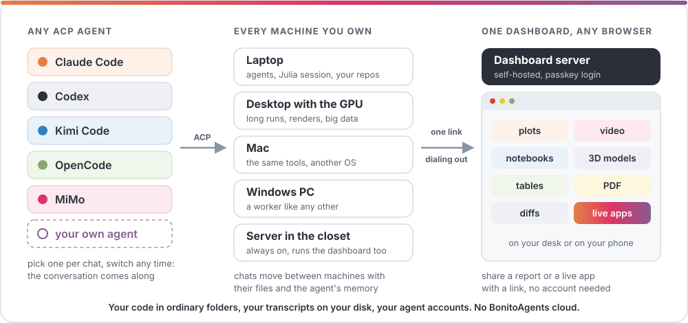
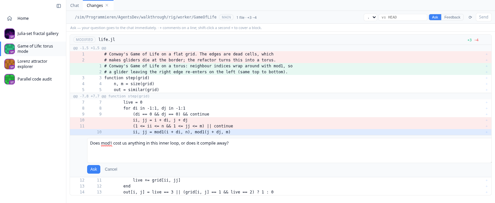
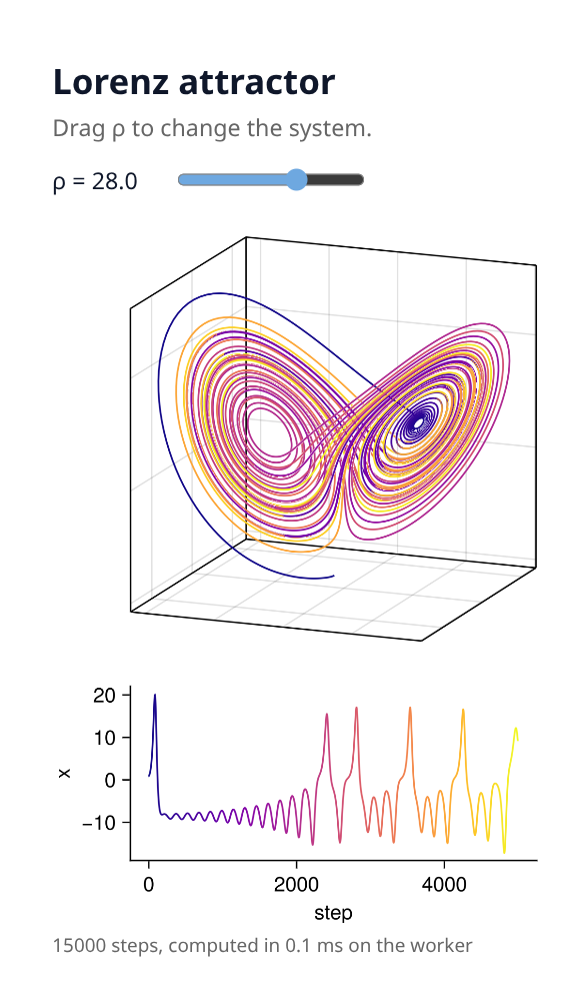

# BonitoAgents

```@raw html
<div class="ba-home">
<section id="watch" aria-label="BonitoAgents in action">
  <div class="ba-section-heading"><p class="ba-eyebrow">From a question to something you can use</p><span class="ba-meta">39 seconds · captions included</span></div>
  <figure class="ba-demo">
    <video id="workflow-demo" controls muted playsinline preload="metadata" poster="assets/workflow-poster.jpg" aria-label="Build and explore a curve-fitting app, check its results, and dock it beside the conversation">
      <source src="assets/workflow.mp4" type="video/mp4">
      <track kind="captions" src="assets/workflow.vtt" srclang="en" label="English" default>
      <a href="assets/workflow.mp4">Watch the workflow video</a>.
    </video>
    <figcaption>Real Julia execution and a live app. The conversation is scripted so the example is reproducible.</figcaption>
  </figure>
  <div class="ba-chapters" aria-label="Video chapters">
    <button type="button" data-demo-time="0"><span>01</span><strong>Explore the result</strong><small>Change the fit and see it update.</small></button>
    <button type="button" data-demo-time="8"><span>02</span><strong>Check the computation</strong><small>Read the code and watch results arrive.</small></button>
    <button type="button" data-demo-time="24"><span>03</span><strong>Make room to work</strong><small>Keep the live app beside the conversation.</small></button>
  </div>
</section>

<section class="ba-section">
  <div class="ba-section-heading"><h2>One place for the whole loop.</h2><p>Ask. Inspect. Refine.</p></div>
  <div class="ba-pillars">
    <article><p class="ba-eyebrow">Your choice of agent</p><h3>Keep the work. Switch the agent.</h3><p>Use Claude Code, Codex, Kimi Code, OpenCode or another ACP agent. Switch within a conversation and carry the history forward.</p><a href="providers.html">Choose an agent →</a></article>
    <article><p class="ba-eyebrow">Your computers</p><h3>Work where the code and hardware are.</h3><p>Connect a laptop, GPU desktop or server to one dashboard. Start work there and follow it from another browser, including your phone.</p><a href="workers.html">Connect your machines →</a></article>
    <article><p class="ba-eyebrow">The actual results</p><h3>Do more than read a reply.</h3><p>Inspect files from any language: plots, notebooks, tables, video, 3D models and git diffs. Julia-powered apps stay interactive while you refine the code.</p><a href="chat.html">Explore the workspace →</a></article>
  </div>
  <figure class="ba-overview"></figure>
</section>

<section class="ba-section ba-workspace">
  <div><p class="ba-eyebrow">See what changed</p><h2>Review the patch beside the result.</h2><p>Open the source, inspect a diff, and ask about a specific line. Keep the plot or app beside the conversation while you decide what to change next.</p><a href="chat.html#Reviewing-changes">Reviewing changes →</a></div>
  <figure><figcaption>Code, context and feedback in the same workspace.</figcaption></figure>
</section>

<section class="ba-section ba-workspace ba-share">
  <figure></figure>
  <div><p class="ba-eyebrow">Let someone else try it</p><h2>Send the working result.</h2><p>Share a report, a file or a live app with a link. A collaborator can open it in their browser and explore it, with computation running on your worker.</p><p class="ba-meta">Your worker stays online to serve the link. You can add a password or revoke access.</p><a href="mcp-tools.html">Sharing files and live apps →</a></div>
</section>

<section class="ba-section ba-start">
  <div><p class="ba-eyebrow">Start with one machine</p><h2>Bring a project. Pick an agent.</h2><p>The installer includes Julia and the app. Your files stay in ordinary folders, and agents use your own subscriptions or API keys.</p></div>
  <div class="ba-start-actions"><a class="VPButton brand" href="getting-started.html">Install BonitoAgents</a><a href="story.html">Follow a complete workflow →</a><a href="https://github.com/SimonDanisch/BonitoAgents.jl">Source on GitHub →</a></div>
</section>
</div>
```

!!! warning "Agent access"
    Agents can run commands and modify files on connected machines. Use projects and permissions you are comfortable giving them access to.
