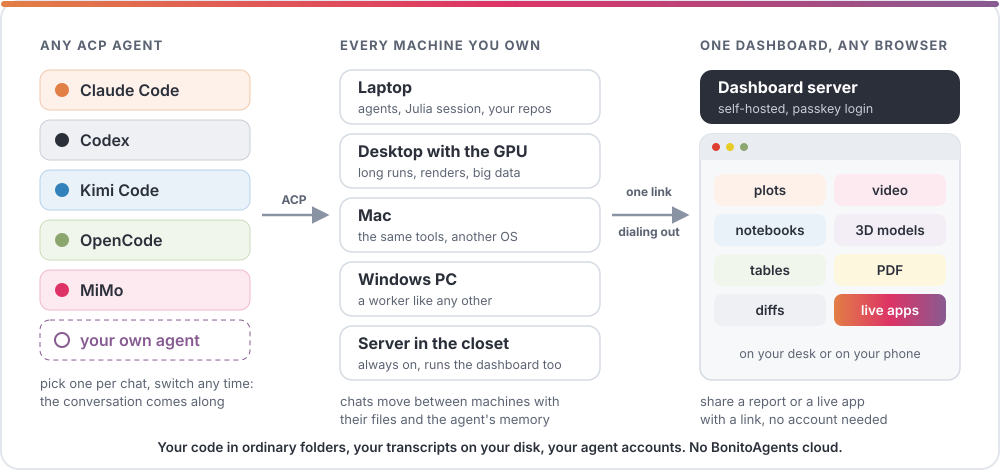
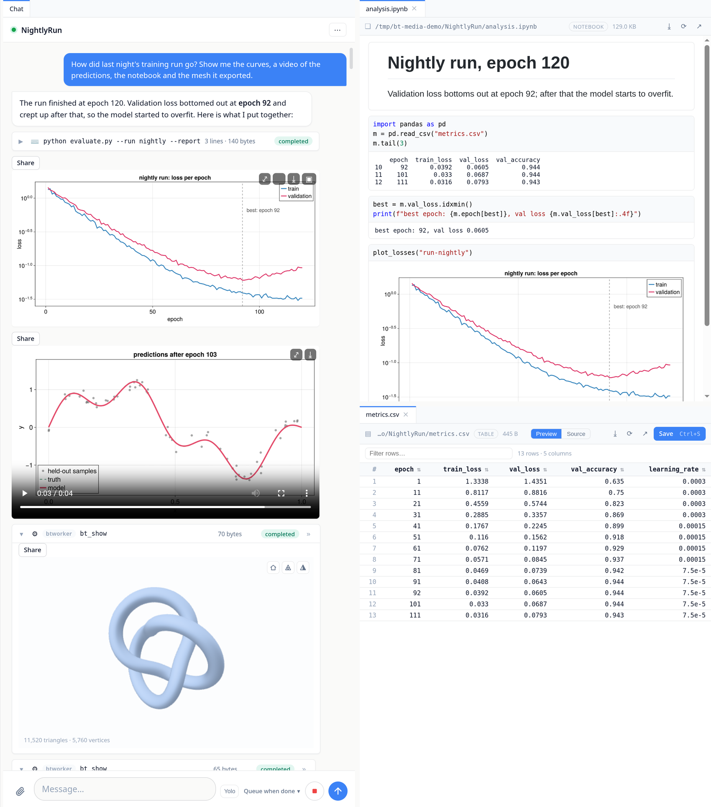

# A Day with BonitoAgents

This page follows one ordinary working day, from the first coffee to the last
render of the evening. Nothing in it is staged: every step is a feature you can
use today, and each one links to the guide that explains it.

The setup is the one many of us already have. A laptop you carry around. A
desktop under the desk with the big GPU. Maybe a Mac, a Windows machine for
the one tool that needs it, a small always-on server in the closet. And
subscriptions to two or three coding agents, because each is good at something
different and each runs out of credits at the worst moment.

```@raw html

```

BonitoAgents puts a small worker on each of those machines. The workers dial
out to one dashboard server that you host yourself, and the dashboard runs in
any browser. Getting there takes one install line per machine
([Getting Started](@ref)).

## 8:40, laptop, coffee

The dashboard shows every chat on every machine as a live card. Claude Code is
refactoring a parser on the laptop. Codex is training a model on the desktop,
next to the GPU and the dataset. Kimi Code is tidying the docs on the home
server. Each card carries a picture from its chat's latest work: the loss curve
from last night, a screenshot the agent took, the last frame of a render. One
look tells you which chat needs you.

None of these agents is special to BonitoAgents. They all speak the
[Agent Client Protocol](https://agentclientprotocol.com), and BonitoAgents is a
client for it, so each chat simply names the agent it runs. Yesterday's
sessions are still there: **Discover** found the Claude Code and Codex sessions
you started in a terminal last week and imported them, history included.

*More:* [Agent Providers](@ref), [Workers & Machines](@ref).

## 9:15, what did the training run do?

You ask the desktop's agent how the run went. It plots the loss curves, renders
a short video of the model's predictions on held-out data, and writes a notebook
that walks through the numbers. It shows you all three with `bt_show`, and they
open in the conversation as what they are: the plot inline with a lightbox, the
video streamed and seekable, the notebook rendered with its outputs.

It also exported a mesh of the learned geometry, and that opens in an
interactive 3D viewer you can turn with the mouse. The evaluation table is a
CSV, so it opens as a sortable, filterable table. The PDF report opens as a
PDF. Any file in the project tree opens the same way in a workspace tab, and
text formats switch between preview and source and save back to the desktop.

Your project does not have to be written in Julia for any of this. The agent
runs your Python, Rust or TypeScript the way it always does, and BonitoAgents
renders the files it produces.

```@raw html

```

*More:* [The Chat](@ref), [Julia Tools & Live Apps](@ref).

## 11:30, Codex is out of credits

Half way through a refactor, Codex hits its usage limit. The chat says so in a
**Provider error** notice, in the provider's own words, including when the
limit resets. If the chat was running unattended, the loop stops right there
instead of retrying all morning.

So you open the agent picker in the chat's header, choose Claude Code, and
type "carry on". The new agent has never seen this conversation, so
BonitoAgents hands it the conversation so far along with your message. It
continues on the same files, on the same machine, with the same tools. That is
the whole migration.

This is the point of the design. Your projects are ordinary folders and git
checkouts on your own machines. Your transcripts are markdown files in your own
server's state directory. The agents log in with your own subscriptions and API
keys. The BonitoAgents tools (the Julia sessions, `bt_show`, share links, the
to-do list) render as the same cards whichever agent calls them. Nothing here
belongs to a vendor, so nothing has to be exported when you change your mind.

*More:* [Agent Providers](@ref), [Staying in control](@ref).

## 13:00, phone, queue at lunch

The agent on the desktop wants to run a database migration, and it asks first.
The permission prompt shows up on your phone as a form; you approve it. While
you wait you look at the newest render, then take a photo of this morning's
whiteboard sketch with the composer's attach button and send it with the
afternoon's task.

The phone is not a second-class view. Chats, prompts, attachments, media and
live apps work on a small screen, and a tab that slept in your pocket reconnects
to where it was.

*More:* [The Chat](@ref).

## 15:00, a GUI for one parameter

You want to see how the result changes with one parameter, and a script with a
command-line flag is not going to cut it. You ask for a small interface.

The agent has a persistent Julia session per project. Packages, data and
compiled code stay warm between calls, stdout streams while code runs, and a
long job can run in the background while the conversation goes on. It builds
the interface with Bonito and WGLMakie and **returns** it. The app appears in the
conversation and it is live: drag the slider and the computation reruns in the
desktop's Julia session. You detach it into its own panel next to the source
file, and it keeps running while you and the agent change the code under it.

The heavy part of the computation lives on the desktop, but the chat that
started the day on the laptop stays where it is: with **Remote julia** switched
on, the agent can run `bt_julia_eval(code; worker = "desktop")`, and the output
and the live result still land in this conversation. `bt_sync_folder` copies the
code and data across first, and `remote_session` moves Julia values between
machines.

*More:* [Julia Tools & Live Apps](@ref), [Running Julia on another machine](@ref).

## 17:00, review and share

Time to look at what changed. **Review changes** opens the project's git diff
as a workspace tab, new files included. You comment on one line and **Ask**
right away; the question goes into the chat with its code context. Three more
notes go into **Feedback**, and the agent receives them as one numbered
instruction.

A colleague should see the app too. You share it with a link. They open it on
their phone without an account (behind a tunnel, the default setup), move the
slider, and your desktop does the computing; every visitor gets their own copy
of the app. The report the agent
wrote goes out the same way, as a web page with its pictures and videos. Links
can have a password, and Settings lists them so you can end any of them.

*More:* [Reviewing changes](@ref), [Julia Tools & Live Apps](@ref).

## 18:30, Yolo for the evening

There is one more long job: the final, high-resolution render. You switch on
**Yolo** and add a reminder, "render the HD version, credits at the end". From
now on the chat nudges the agent to keep going whenever it pauses, with your
reminder attached every time.

Yolo has brakes. The agent leaves the loop by saying it is done and then
confirming it when asked "are you really done?". The loop also stops on its own
when a turn fails, when the provider reports an error such as an exhausted
quota, when the agent refuses, when it gives the same answer three times
without doing anything, and when it goes several turns without running a tool.
A turn that only compacts the conversation does not count as work. Either way,
the chat tells you why it stopped.

You close the laptop. The worker on the desktop keeps the session; the
dashboard on your phone shows the render's progress whenever you look.

*More:* [Staying in control](@ref).

## The rest of the week

- **Continue on another machine.** The desktop is busy, so you continue a chat
  on the Mac from the chat's ⋯ menu. The files move, and so does the agent's own
  memory of the conversation ([Continuing a chat on another worker](@ref)).
- **One to-do list for everything.** The bundled To-do app keeps one list for
  the whole server. Any agent can add and check off items, and **Start chat**
  opens a chat for an item in the right project folder ([Apps](@ref)).
- **Your own app.** An app is a Julia package that lays out its own chat pane
  and gives every agent new tools ([Writing an app](@ref)).
- **Teammates.** On a server installed with `install_server.sh`, people sign in
  with passkeys, admins put them in groups, and groups share workers
  ([Getting Started](@ref)).
- **When something breaks.** **Debug BonitoAgents** opens an agent on the
  BonitoAgents source with tools for the running system: state, logs from every
  machine, browser consoles, timings and memory. It reproduces the problem,
  fixes it and runs the tests ([Development](@ref)).
